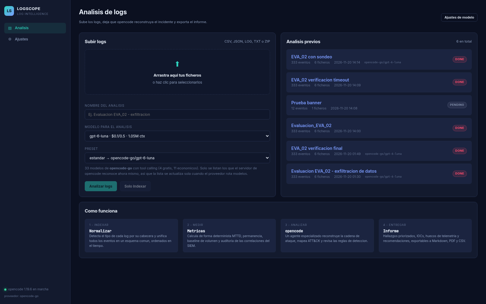
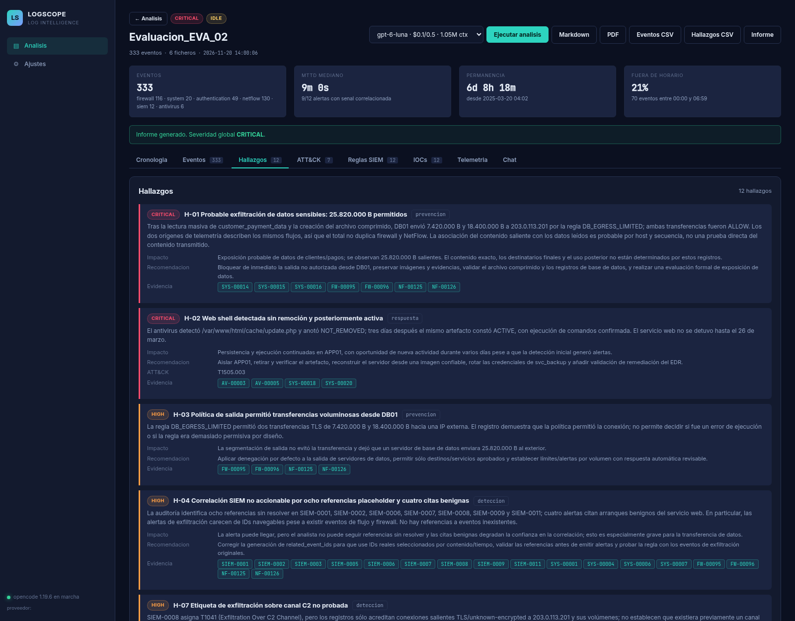
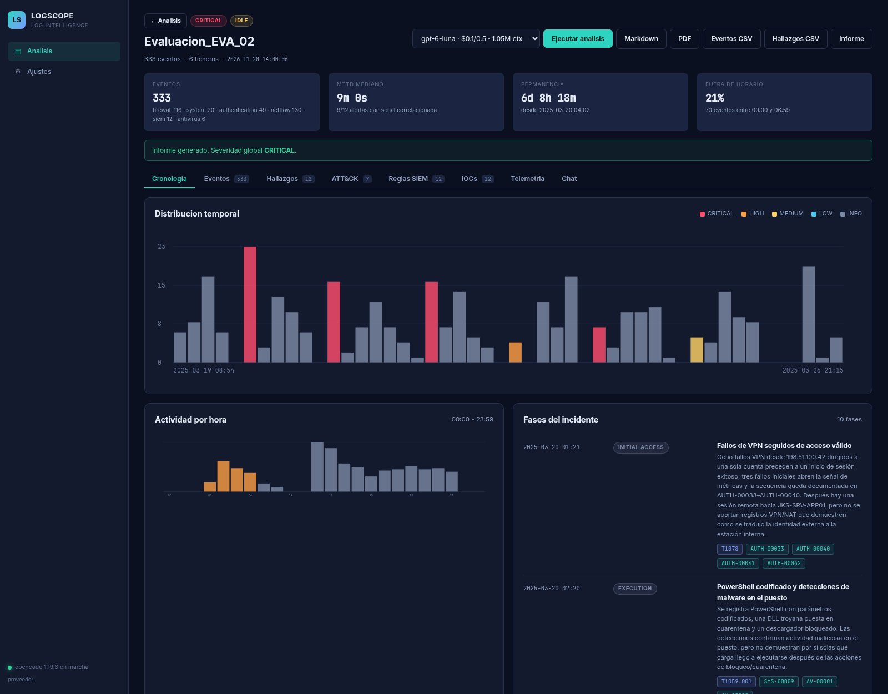
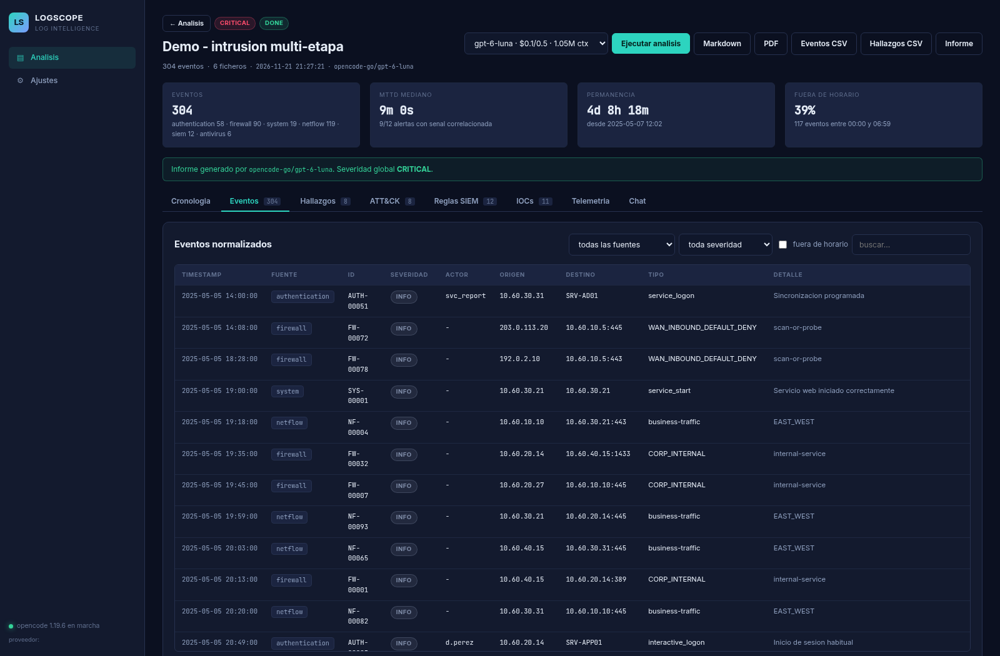
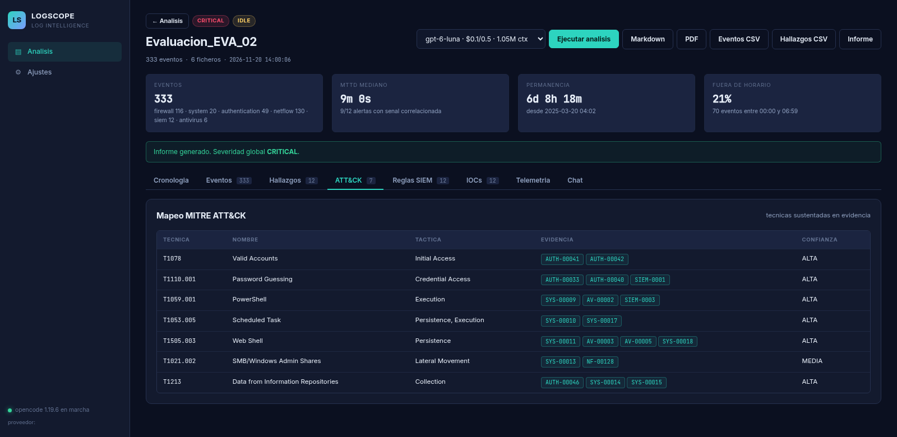
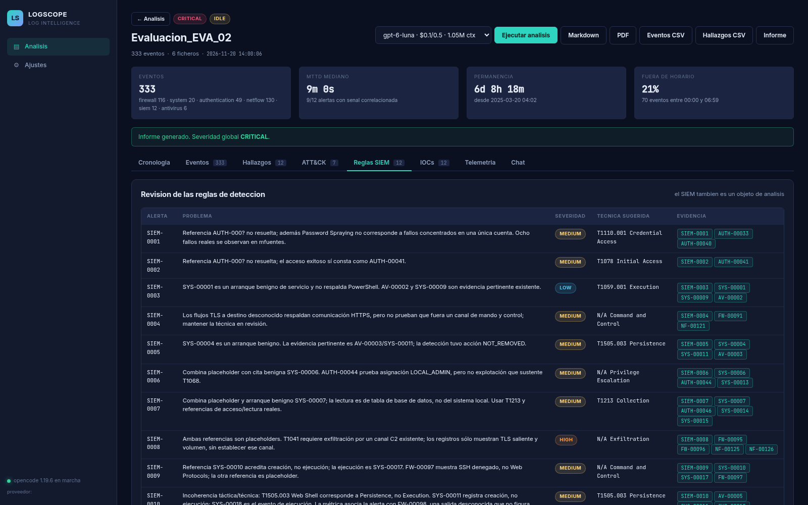
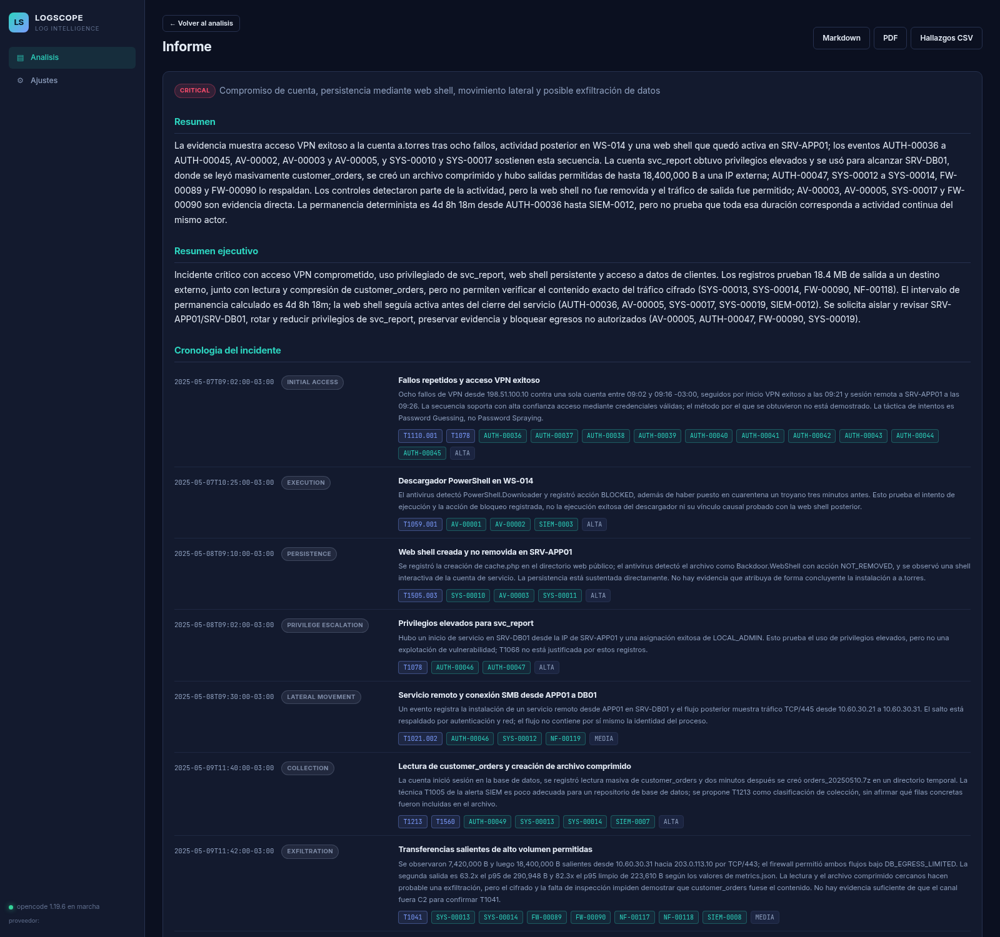
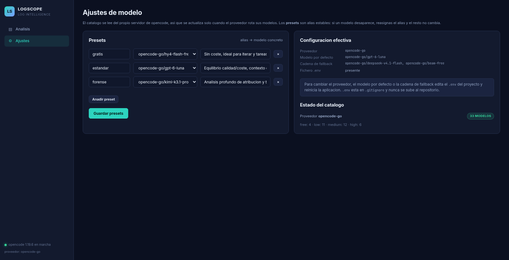

<div align="center">


# 🛡️ LogScope

### **AI-powered security log analysis — powered exclusively by `opencode-go`**

**Upload your firewall, authentication, netflow, EDR and SIEM logs → get a forensic incident report with evidence-backed findings, MITRE ATT&CK mapping, SIEM rule audit and IOCs.**

[](https://www.python.org/)
[](https://fastapi.tiangolo.com/)
[](https://opencode.ai)
[](https://opencode.ai)
[](https://github.com/)
[](LICENSE)

<p>
  <a href="#-screenshots">📸 Screenshots</a> •
  <a href="#-why-opencode-go">🤖 Why opencode-go</a> •
  <a href="#-how-it-works">⚙️ How it works</a> •
  <a href="#-quick-start">🚀 Quick start</a> •
  <a href="#-model-selection">🎛️ Model selection</a> •
  <a href="#-the-agent">🧠 The agent</a> •
  <a href="#-api">🔌 API</a>
</p>

<p>
  <a href="README.md">🇪🇸 Español</a> ·
  <b>🇬🇧 English</b>
</p>

</div>

---

## ❓ The problem

Security teams drown in logs. The tools that help either **cost per token**
(API-based copilots) or **guess with vectors** (RAG over log chunks). Both
fail on the questions that matter in an audit:

> *Does the SIEM alert actually point to the event it claims?*
> *Is this "password spraying" or just one account being guessed?*
> *Was the threat actually remediated, or only detected?*

LogScope takes a different route: **deterministic analysis in Python, judgement
by an opencode agent.** Nothing is guessed, every claim cites real event IDs.

---

## ✨ What it does

| | |
|---|---|
| 🧩 **Detects log types automatically** | Fingerprints on the **header**, not the filename. 7 known profiles + a generic fallback for anything else. No configuration, no schema mapping. |
| ⏱️ **Computes the hard numbers** | MTTD, dwell time, off-hours ratio, volume baseline and correlation integrity — all in Python, reproducible, verifiable. |
| 🤖 **Reconstructs the attack** | An opencode agent rebuilds the kill chain phase by phase (Initial Access → Execution → Persistence → Priv Esc → Lateral Movement → Collection → Exfiltration → Containment). |
| 🎯 **Audits the SIEM itself** | Flags placeholder references, citations pointing at benign events, non-existent IDs, wrong tactics and **mis-applied ATT&CK techniques**. |
| 🧾 **Exports the evidence** | Markdown, PDF (8 pages, styled) and CSV for findings and events. |
| 💬 **Answers follow-up questions** | Context-aware chat over the same workspace, with the model chosen per question. |

---

## 📸 Screenshots

### 🏠 Upload & model selection



### 🧩 Findings with evidence, ATT&CK and recommendations



### 📊 Timeline, detection latency and dwell time



### 🗂️ Filterable event table



### 🔎 ATT&CK mapping and SIEM rule audit

| ATT&CK mapping | SIEM rule review |
|---|---|
|  |  |

### 📄 The generated report



> Drop your own screenshots in `docs/screenshots/` and reference them with the same
> naming scheme (`01-…`, `02-…`, …) — the layout above is the intended order.

---

## 🤖 Why opencode-go

**LogScope is built to work with `opencode-go` and nothing else.** That is a
deliberate decision, not a limitation.

### ✅ Only `opencode-go` models are ever offered

The catalogue is read **live** from the opencode server (`GET /provider`) and
filtered to the configured provider. When `opencode-go` rotates its providers
next month, the dropdown updates itself — **no code change, no redeploy**.

```
33 models · 4 free · 11 cheap · 12 mid · 6 premium
```

### ✅ Tool-calling is mandatory

opencode does **not** validate that a model supports tool calls. A model
without them would be accepted and then break the agent the moment it tried
to read a log file. LogScope filters on `capabilities.toolcall == true`
before showing anything.

### ✅ Presets survive the rotation

Users never bind to a model, they bind to an **alias**:

| Preset | Model | Cost in/out | Purpose |
|---|---|---|---|
| `gratis` | `opencode-go/hy4-flash-free` | **0 / 0** | Iterating, CI, bulk triage |
| `estandar` | `opencode-go/gpt-6-luna` | $0.1 / $0.5 | Default · 1.05M context |
| `forense` | `opencode-go/kimi-k3.1-pro` | $2 / $10 | Deep attribution |

If a model disappears, you re-point the alias in **Ajustes / Settings** — one
click, nothing else changes.

### ✅ Automatic fallback

A model can be retired mid-month. If the request fails with opencode's
`HTTP 500 UnknownError`, LogScope retries down the chain
(`gpt-6-luna → deepseek-v4.1-flash → beam-free`) and **records in the report
which model produced each section**.

### ✅ Credentials stay with opencode

LogScope never stores API keys. It drives the opencode CLI, which already
holds your session:

```bash
opencode providers login      # if you ever need to re-authenticate
```

---

## ⚙️ How it works

```
 ┌─────────────┐   ┌─────────────┐   ┌──────────────┐   ┌────────────┐
 │  📥 INGEST  │   │  📏 MEASURE │   │  🤖 ANALYZE  │   │  📦 DELIVER │
 ├─────────────┤   ├─────────────┤   ├──────────────┤   ├────────────┤
 │ fingerprint │──▶│ MTTD        │──▶│ opencode-go  │──▶│ Markdown   │
 │ by header   │   │ dwell time  │   │ log-analyst  │   │ PDF        │
 │ 7 profiles  │   │ baseline    │   │ agent + skill│   │ CSV        │
 │ + fallback  │   │ integrity   │   │ streamed SSE │   │            │
 └─────────────┘   └─────────────┘   └──────────────┘   └────────────┘
    ⚡ instant          ⚡ instant          ⏱️ 2–8 min         ⚡ instant
```

**The split is the whole point.** The model never does arithmetic and Python
never does judgement:

- **Python owns the numbers.** MTTD, dwell time, percentile baselines and
  correlation integrity are computed deterministically. The model cannot
  hallucinate an MTTD because it never computes one — it reads it.
- **opencode owns the judgement.** Which phase a technique belongs to, whether
  a control actually failed, how severe a finding is, what to recommend, and
  above all **whether the evidence supports the claim**.

Every finding in the report carries the event IDs that back it. If the
evidence does not close, the agent documents a **telemetry gap** instead of
inventing a story.

### 📐 What the demo dataset produces

Run against the bundled synthetic dataset (304 events, auth → firewall →
netflow → EDR → SIEM):

| Finding | Detected by LogScope |
|---|---|
| 🔴 Sensitive table read followed by 25.8 MB of permitted egress | `SYS-00013`, `FW-00089/90`, `NF-00117/18` |
| 🔴 Web shell detected with `NOT_REMOVED`, still `ACTIVE` three days later | `AV-00003` → `AV-00005` |
| 🟠 Valid-account VPN access preceded by brute force on a **single** account | `AUTH-00037…44`, `SIEM-0001/0002` |
| 🟠 Containment happened **after** the data was already gone | `SIEM-0012` |
| 🟠 8 SIEM alerts with unresolvable `AUTH-000?` placeholders, 4 citing benign events | `siem_alerts.csv` |
| 🟠 `T1110.003 Password Spraying` applied to **one** account → correctly `T1110.001` | `SIEM-0001` |
| 🟡 Internal IPs with no asset owner and a missing pivot between segments | `integrity.json` |

---

## 🚀 Quick start

**Requirements:** Python 3.11+ · [opencode](https://opencode.ai) 1.19+ with
`opencode-go` connected.

```bash
git clone https://github.com/jorge-hacks/LogScope.git
cd logscope

# venv con uv (o con pip: python -m venv .venv && . .venv/bin/activate)
uv venv .venv --python 3.13
uv pip install --python .venv/bin/python -e ".[dev]"

cp .env.example .env
./scripts/run.sh
```

Open **http://127.0.0.1:8000** and drop your logs on it.

LogScope **starts and supervises its own headless opencode server** — there is
nothing else to launch.

<details>
<summary>🐍 Without uv</summary>

```bash
python -m venv .venv && . .venv/bin/activate
pip install -e ".[dev]"
python -m uvicorn server.main:app --port 8000
```
</details>

---

## ⚙️ Configuration

Everything is environment driven (`.env`, which is **never committed**).

| Variable | Default | Description |
|---|---|---|
| `LOGSCOPE_HOST` / `LOGSCOPE_PORT` | `127.0.0.1` / `8000` | Dashboard address |
| `LOGSCOPE_OPENCODE_BIN` | `opencode` | Path to the opencode binary |
| `LOGSCOPE_OPENCODE_PORT` | `4099` | Port for the managed headless server |
| `LOGSCOPE_PROVIDER` | `opencode-go` | **The only provider allowed** |
| `LOGSCOPE_MODEL` | `opencode-go/gpt-6-luna` | Default analysis model |
| `LOGSCOPE_SMALL_MODEL` | `opencode-go/hy4-flash-free` | Auxiliary model (titles, compaction) |
| `LOGSCOPE_AGENT` | `log-analyst` | opencode agent that runs the analysis |
| `LOGSCOPE_FALLBACK_MODELS` | `deepseek-v4.1-flash,beam-free` | Retry chain |
| `LOGSCOPE_ANALYSIS_TIMEOUT` | `900` | Seconds before a stuck turn is cut loose |
| `LOGSCOPE_MAX_UPLOAD_MB` | `64` | Per-file upload limit |

Precedence: **UI → environment → preset → default.**

---

## 🎛️ Model selection



- **Live dropdown** in the analysis screen and in the chat, grouped by cost tier
  with the context window and $/Mtoken shown.
- **Editable presets** — aliases that survive the monthly provider rotation.
- **Per-message model in chat** — escalate a single hard question to a premium
  model without re-running the whole analysis.
- **Automatic fallback** with the reason recorded in the report.

---

## 🧠 The agent

Two files drive the analysis quality:

| File | Role |
|---|---|
| `.opencode/agent/log-analyst.md` | The agent: scoped permissions (read, edit inside the workspace, bash; **`webfetch`/`websearch` denied** so it cannot wander), plus a pre-delivery checklist. |
| `.opencode/skill/log-forensics/SKILL.md` | The methodology: baseline before anomaly, phase-by-phase reconstruction, SIEM self-audit, severity rubric, how to write down telemetry gaps, and the exact output schema. |

The agent's `report.json` is **validated against a Pydantic schema**. If it
does not validate, the backend re-prompts the agent with the validation errors
so it can fix its own output. A report is only published when the structure
is sound.

---

## 📂 Supported log formats

Detection is based on the **header**, so it works with any vendor's export.

| Type | Columns that identify it |
|---|---|
| Authentication | `event_id, timestamp, username, source_ip, event_type, result` |
| Firewall | `event_id, timestamp, src_ip, dst_ip, dst_port, action, rule_name` |
| Netflow | `flow_id, start_time, src_ip, dst_ip, dst_port, bytes, direction` |
| Antivirus / EDR | `event_id, timestamp, threat_name, detection_status, action_taken` |
| SIEM alerts | `alert_id, timestamp, tactic, technique_id, severity` |
| System / Audit | `event_id, timestamp, hostname, log_source, event_type, message` |
| **Generic** | anything else — fields inferred by column-name similarity |

ZIP archives are expanded automatically.

---

## 🔌 API

| Method | Route | Description |
|---|---|---|
| `GET` | `/api/health` | App and opencode engine status |
| `GET` | `/api/models` | Live model catalogue + presets |
| `POST` | `/api/presets` | Save presets |
| `POST` | `/api/upload` | Upload, normalise and index |
| `GET` | `/api/analysis/{id}` | Metrics, integrity, report, run state |
| `GET` | `/api/analysis/{id}/events` | Filtered events (source, severity, text, hours) |
| `GET` | `/api/analysis/{id}/timeline` | Time and hour histograms |
| `POST` | `/api/analysis/{id}/analyze` | Launch the analysis |
| `GET` | `/api/analysis/{id}/stream` | SSE with live progress |
| `POST` | `/api/analysis/{id}/chat` | Follow-up questions (SSE) |
| `GET` | `/api/analysis/{id}/export/{md,pdf,findings.csv,events.csv}` | Exports |

Interactive OpenAPI docs at **`/docs`**.

---

## 📁 Project structure

```
server/      main.py (FastAPI), oc_client.py, oc_manager.py, schemas.py, config.py
ingest/      detect.py (fingerprint), profiles.py (7 profiles), normalize.py
analysis/    metrics.py (MTTD, baseline, dwell), integrity.py (quality, correlation)
models/      catalog.py (live catalogue, tiers, presets)
exporter/    Markdown, PDF (reportlab) and CSV
.opencode/   agent/log-analyst.md and skill/log-forensics/SKILL.md
templates/   base, index, analysis, settings, report
static/      css/theme.css (custom dark SOC theme) and js/
scripts/     run.sh, restart.sh, screenshots.sh, seed_demo.py
docs/        logo.svg and screenshots/ used by this README
tests/       pytest
```

---

## 🧪 Development

```bash
.venv/bin/pytest          # 61 tests
.venv/bin/ruff check .    # lint
./scripts/restart.sh      # clean restart (app + opencode)

# preload an example case (indexes it, does not run the agent)
.venv/bin/python scripts/seed_demo.py /path/to/logs "Case name"
```

CI runs on every push: lint + tests + an import/contract check.

---

## 🔐 Security notes

- **LogScope never stores API keys.** Authentication lives with opencode.
- **Uploaded logs never leave the machine.** Everything runs locally.
- **The report renders escaped.** Content coming from the logs is untrusted by
  definition, so the UI escapes it — no raw HTML, no external CDN.
- **Workspaces are git-ignored.** Customer data is never committed by accident.
- The agent runs with `webfetch`/`websearch` **denied** and `external_directory`
  restricted to the project.

---

## 📝 Implementation notes

The opencode **1.x** API differs from the published v2 docs. LogScope uses the
v1 surface verified against the local binary:

- v1 routes have **no `/api` prefix**: `POST /session`, `POST /session/{id}/message`, `GET /event`
- `POST /session` takes `directory` as a **query parameter**, not in the body
- `GET /event` requires `?directory=<dir>` or no session events arrive
- The model travels **per message**, so it can change mid-chat
- Unknown routes return `200` with the opencode web UI HTML — the client
  validates `content-type`, not just the status code
- A non-existent model yields `HTTP 500 {"name":"UnknownError"}` — the trigger
  for the fallback chain

---

---

## 🎲 Try it with the demo dataset

The repository ships a **synthetic dataset** that reproduces the structure of a
real investigation — 304 events across six sources, with a multi-stage intrusion
(credential access, execution, persistence, lateral movement, collection and
exfiltration) over a background of normal traffic. Every hostname, user and
address is invented; the external ones belong to the RFC 5737 documentation
ranges.

```bash
python scripts/demo_dataset.py --output /tmp/demo_logs
```

Then upload the six generated CSV files from the dashboard, or use the seed
helper:

```bash
.venv/bin/python scripts/seed_demo.py /tmp/demo_logs "Demo - intrusion multi-stage"
```

The screenshots in this README were produced with exactly this dataset.

---

## 📄 License

MIT — see [LICENSE](LICENSE).

<p align="center">
  <sub>Built with 🛡️ for defenders. Powered by <a href="https://opencode.ai">opencode</a> and <code>opencode-go</code>.</sub>
</p>
