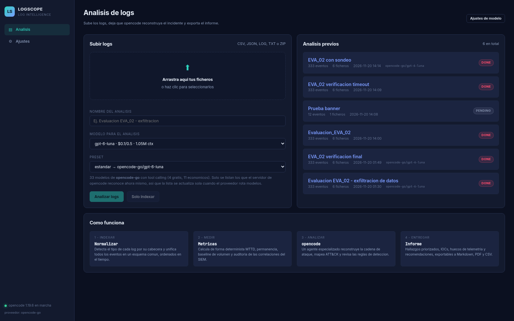
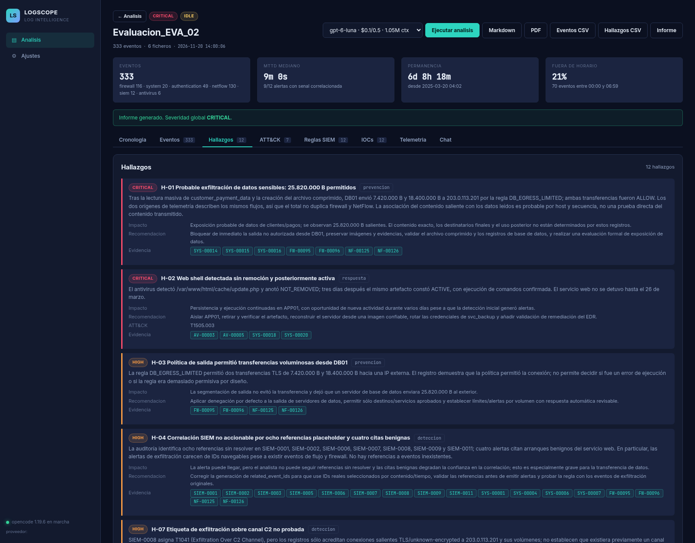
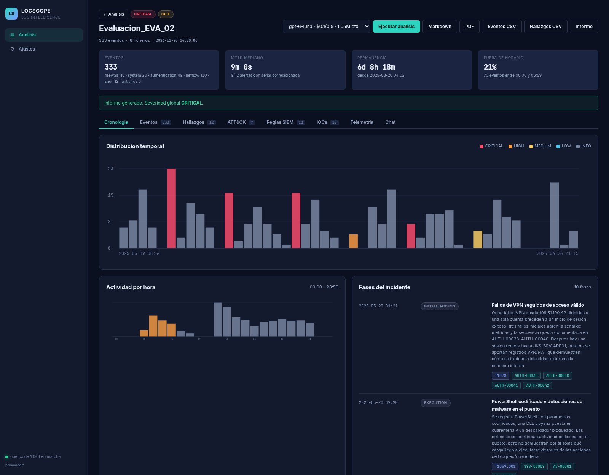
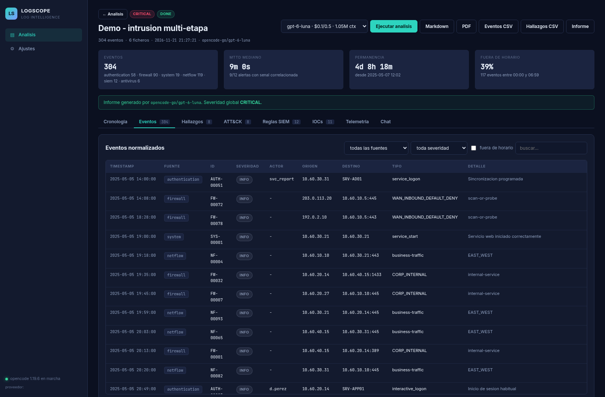
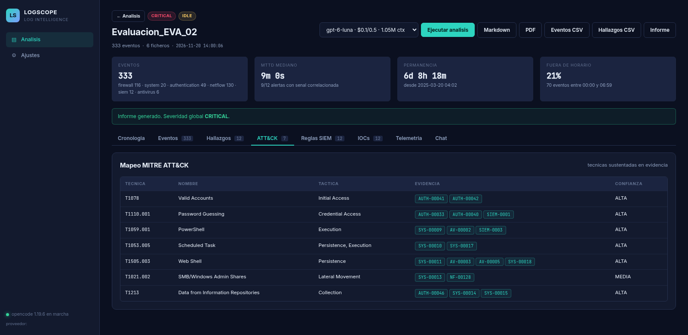
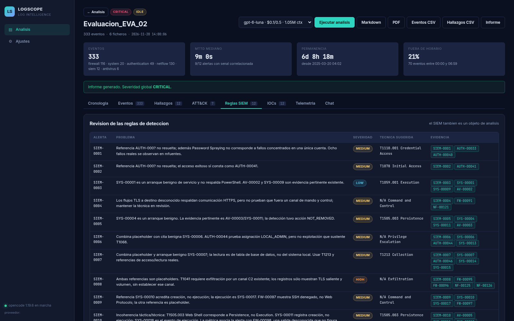
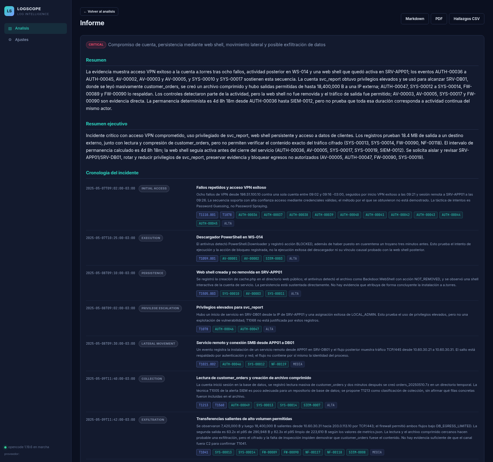
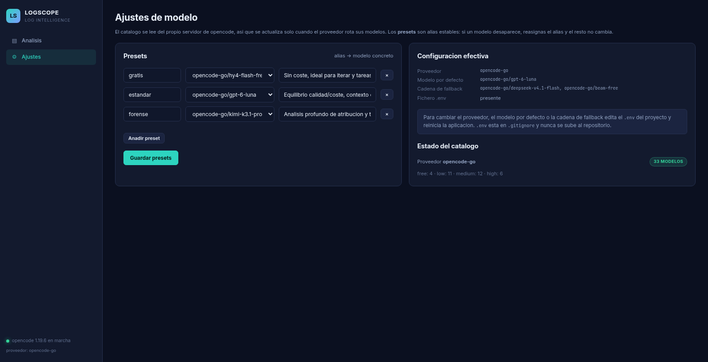

<div align="center">


# 🛡️ LogScope

### **Análisis forense de logs con IA — funciona explícitamente con `opencode-go`**

**Sube tus logs de firewall, autenticación, netflow, EDR y SIEM → obtén un informe forense con hallazgos sustentados en evidencia, mapeo MITRE ATT&CK, auditoría de las reglas del SIEM e IOCs.**

[](https://www.python.org/)
[](https://fastapi.tiangolo.com/)
[](https://opencode.ai)
[](https://opencode.ai)
[](https://github.com/)
[](LICENSE)

<p>
  <a href="#-capturas">📸 Capturas</a> •
  <a href="#-por-qu%C3%A9-opencode-go">🤖 Por qué opencode-go</a> •
  <a href="#-c%C3%B3mo-funciona">⚙️ Cómo funciona</a> •
  <a href="#-arranque-r%C3%A1pido">🚀 Arranque</a> •
  <a href="#-selecci%C3%B3n-de-modelo">🎛️ Selección de modelo</a> •
  <a href="#-el-agente">🧠 El agente</a> •
  <a href="#-api">🔌 API</a>
</p>

<p>
  <b>🇪🇸 Español</b> ·
  <a href="README.en.md">🇬🇧 English</a>
</p>

</div>

---

## ❓ El problema

Los equipos de seguridad se ahogan en logs. Las herramientas que ayudan o
**cobran por token** (copilotos con API) o **adivinan con vectores** (RAG
sobre fragmentos de log). Ambas fallan en las preguntas que importan en una
auditoría:

> ¿Apunta de verdad la alerta del SIEM al evento que dice señalar?
> ¿Esto es *password spraying* o una sola cuenta a la que se adivina?
> ¿Se eliminó la amenaza o solo se detectó?

LogScope toma otro camino: **análisis determinista en Python, juicio de un
agente de opencode.** Nada se inventa, cada afirmación cita IDs de evento
reales.

---

## ✨ Qué hace

| | |
|---|---|
| 🧩 **Detecta el tipo de log automáticamente** | Por la **cabecera**, no por el nombre del fichero. 7 perfiles conocidos + un modo genérico para cualquier otra cosa. Sin configuración ni mapeo de esquemas. |
| ⏱️ **Calcula las cifras difíciles** | MTTD, permanencia, ratio nocturno, baseline de volumen e integridad de correlaciones — todo en Python, reproducible y verificable. |
| 🤖 **Reconstruye el ataque** | Un agente de opencode rehace la kill chain fase a fase (Acceso Inicial → Ejecución → Persistencia → Escalada → Movimiento Lateral → Colección → Exfiltración → Contención). |
| 🎯 **Audita al propio SIEM** | Señala referencias placeholder, citas que apuntan a eventos benignos, IDs inexistentes, tácticas incorrectas y **técnicas ATT&CK mal aplicadas**. |
| 🧾 **Exporta la evidencia** | Markdown, PDF (8 páginas maquetadas) y CSV de hallazgos y eventos. |
| 💬 **Responde preguntas de seguimiento** | Chat con contexto sobre el mismo workspace, con el modelo que elijas en cada pregunta. |

---

## 📸 Capturas

### 🏠 Subida de logs y selección de modelo



### 🧩 Hallazgos con evidencia, ATT&CK y recomendaciones



### 📊 Cronología, latencia de detección y permanencia



### 🗂️ Tabla de eventos filtrable



### 🔎 Mapeo ATT&CK y auditoría de reglas del SIEM

| Mapeo ATT&CK | Auditoría de reglas SIEM |
|---|---|
|  |  |

### 📄 El informe generado



> Deja tus propias capturas en `docs/screenshots/` con el mismo esquema de
> nombres (`01-…`, `02-…`, …): el orden de arriba es el previsto.

---

## 🤖 Por qué opencode-go

**LogScope está construido para funcionar con `opencode-go` y nada más.** Es
una decisión deliberada, no una limitación.

### ✅ Solo se ofrecen modelos de `opencode-go`

El catálogo se lee **en vivo** del servidor de opencode (`GET /provider`) y se
filtra al proveedor configurado. Cuando `opencode-go` rote sus proveedores el
mes que viene, el desplegable se actualiza solo: **sin cambios de código y sin
re-desplegar**.

```
33 modelos · 4 gratis · 11 económicos · 12 medios · 6 premium
```

### ✅ El tool calling es obligatorio

opencode **no** comprueba que un modelo soporte llamadas a herramientas. Acepta
uno que no las tiene y el agente se rompe en cuanto intenta leer un log.
LogScope filtra por `capabilities.toolcall == true` antes de mostrar nada.

### ✅ Los presets sobreviven a la rotación

El usuario nunca se ata a un modelo, se ata a un **alias**:

| Preset | Modelo | Coste in/out | Para qué |
|---|---|---|---|
| `gratis` | `opencode-go/hy4-flash-free` | **0 / 0** | Iterar, CI, triaje masivo |
| `estandar` | `opencode-go/gpt-6-luna` | $0.1 / $0.5 | Por defecto · contexto 1.05M |
| `forense` | `opencode-go/kimi-k3.1-pro` | $2 / $10 | Atribución en profundidad |

Si un modelo desaparece, reasignas el alias en **Ajustes**: un clic y no
cambia nada más.

### ✅ Fallback automático

Un modelo puede ser retirado a mitad de mes. Si la petición falla con el
`HTTP 500 UnknownError` de opencode, LogScope reintenta por la cadena
(`gpt-6-luna → deepseek-v4.1-flash → beam-free`) y **deja constancia en el
informe de qué modelo produjo cada sección**.

### ✅ Las credenciales se quedan en opencode

LogScope no almacena ninguna API key: usa el CLI de opencode, que ya tiene tu
sesión.

```bash
opencode providers login      # por si algún día hay que reautenticar
```

---

## ⚙️ Cómo funciona

```
 ┌─────────────┐   ┌─────────────┐   ┌──────────────┐   ┌────────────┐
 │  📥 INGESTA │   │  📏 MEDIR   │   │  🤖 ANALIZAR │   │  📦 ENTREGAR│
 ├─────────────┤   ├─────────────┤   ├──────────────┤   ├────────────┤
 │ fingerprint │──▶│ MTTD        │──▶│ opencode-go  │──▶│ Markdown   │
 │ por cabecera│   │ permanencia │   │ log-analyst  │   │ PDF        │
 │ 7 perfiles  │   │ baseline    │   │ agente+skill │   │ CSV        │
 │ + genérico  │   │ integridad  │   │ SSE en vivo  │   │            │
 └─────────────┘   └─────────────┘   └──────────────┘   └────────────┘
    ⚡ instantáneo      ⚡ instantáneo        ⏱️ 2–8 min        ⚡ instantáneo
```

**El reparto es la clave.** El modelo nunca hace aritmética y Python nunca
opina:

- **Python es dueño de las cifras.** MTTD, permanencia, percentiles e
  integridad se calculan de forma determinista. El modelo no puede inventarse
  un MTTD porque nunca lo calcula: lo lee.
- **opencode es dueño del juicio.** A qué fase pertenece una técnica, si un
  control falló de verdad, la severidad de un hallazgo, qué recomendar y, sobre
  todo, **si la evidencia sostiene la afirmación**.

Cada hallazgo del informe lleva los IDs de evento que lo respaldan. Si la
evidencia no cierra, el agente documenta un **hueco de telemetría** en lugar de
inventarse una historia.

### 📐 Qué produce el dataset de demostración

Ejecutado sobre el dataset sintético incluido (304 eventos, auth → firewall →
netflow → EDR → SIEM):

| Hallazgo | Detectado por LogScope |
|---|---|
| 🔴 Lectura de tabla sensible seguida de 25,8 MB de egreso permitido | `SYS-00013`, `FW-00089/90`, `NF-00117/18` |
| 🔴 Web shell detectada con `NOT_REMOVED`, todavía `ACTIVE` tres días después | `AV-00003` → `AV-00005` |
| 🟠 Acceso VPN con cuenta válida tras fuerza bruta sobre **una sola** cuenta | `AUTH-00037…44`, `SIEM-0001/0002` |
| 🟠 La contención ocurrió **después** de que los datos ya se hubieran ido | `SIEM-0012` |
| 🟠 8 alertas del SIEM con placeholders `AUTH-000?` sin resolver y 4 que citan eventos benignos | `siem_alerts.csv` |
| 🟠 `T1110.003 Password Spraying` aplicado a **una** cuenta → correctamente `T1110.001` | `SIEM-0001` |
| 🟡 IP internas sin activo asociado y un salto entre segmentos sin evidencia | `integrity.json` |

---

## 🚀 Arranque rápido

**Requisitos:** Python 3.11+ · [opencode](https://opencode.ai) 1.19+ con
`opencode-go` conectado.

```bash
git clone https://github.com/jorge-hacks/LogScope.git
cd logscope

# venv con uv (o con pip: python -m venv .venv && . .venv/bin/activate)
uv venv .venv --python 3.13
uv pip install --python .venv/bin/python -e ".[dev]"

cp .env.example .env
./scripts/run.sh
```

Abre **http://127.0.0.1:8000** y arrastra tus logs.

LogScope **arranca y supervisa su propio servidor headless de opencode**: no
hay nada más que lanzar.

<details>
<summary>🐍 Sin uv</summary>

```bash
python -m venv .venv && . .venv/bin/activate
pip install -e ".[dev]"
python -m uvicorn server.main:app --port 8000
```
</details>

---

## ⚙️ Configuración

Todo va por variables de entorno (`.env`, que **nunca se versiona**).

| Variable | Por defecto | Descripción |
|---|---|---|
| `LOGSCOPE_HOST` / `LOGSCOPE_PORT` | `127.0.0.1` / `8000` | Dirección del dashboard |
| `LOGSCOPE_OPENCODE_BIN` | `opencode` | Ruta al ejecutable de opencode |
| `LOGSCOPE_OPENCODE_PORT` | `4099` | Puerto del servidor headless gestionado |
| `LOGSCOPE_PROVIDER` | `opencode-go` | **Único proveedor permitido** |
| `LOGSCOPE_MODEL` | `opencode-go/gpt-6-luna` | Modelo por defecto del análisis |
| `LOGSCOPE_SMALL_MODEL` | `opencode-go/hy4-flash-free` | Modelo auxiliar (títulos, compaction) |
| `LOGSCOPE_AGENT` | `log-analyst` | Agente de opencode que ejecuta el análisis |
| `LOGSCOPE_FALLBACK_MODELS` | `deepseek-v4.1-flash,beam-free` | Cadena de reintentos |
| `LOGSCOPE_ANALYSIS_TIMEOUT` | `900` | Segundos antes de soltar un turno colgado |
| `LOGSCOPE_MAX_UPLOAD_MB` | `64` | Límite por fichero |

Precedencia: **UI → entorno → preset → default.**

---

## 🎛️ Selección de modelo



- **Desplegable en vivo** en la pantalla de análisis y en el chat, agrupado por
  tier de coste con la ventana de contexto y el $/Mtoken visibles.
- **Presets editables**: alias que sobreviven a la rotación mensual de
  proveedores.
- **Modelo por mensaje en el chat**: escala una pregunta difícil a un modelo
  premium sin relanzar todo el análisis.
- **Fallback automático**, con el motivo registrado en el informe.

---

## 🧠 El agente

Dos archivos sosten la calidad del análisis:

| Fichero | Papel |
|---|---|
| `.opencode/agent/log-analyst.md` | El agente: permisos acotados (lectura, edición dentro del workspace, bash; **`webfetch`/`websearch` denegados** para que no divague) y una lista de verificación antes de entregar. |
| `.opencode/skill/log-forensics/SKILL.md` | La metodología: baseline antes que anomalía, reconstrucción por fases, auditoría del propio SIEM, rúbrica de severidad, cómo redactar los huecos de telemetría y el esquema exacto de salida. |

El `report.json` que produce el agente se **valida contra un esquema Pydantic**.
Si no valida, el backend vuelve a preguntarle al agente con los errores de
validación para que corrija su propia salida. Un informe solo se publica cuando
la estructura es correcta.

---

## 📂 Formatos de log soportados

La detección se basa en la **cabecera**, así que funciona con la exportación de
cualquier fabricante.

| Tipo | Columnas que lo identifican |
|---|---|
| Autenticación | `event_id, timestamp, username, source_ip, event_type, result` |
| Firewall | `event_id, timestamp, src_ip, dst_ip, dst_port, action, rule_name` |
| Netflow | `flow_id, start_time, src_ip, dst_ip, dst_port, bytes, direction` |
| Antivirus / EDR | `event_id, timestamp, threat_name, detection_status, action_taken` |
| Alertas SIEM | `alert_id, timestamp, tactic, technique_id, severity` |
| Sistema / Auditoría | `event_id, timestamp, hostname, log_source, event_type, message` |
| **Genérico** | cualquier otra cosa: los campos se infieren por similitud de nombres |

Los ZIP se expanden automáticamente.

---

## 🔌 API

| Método | Ruta | Descripción |
|---|---|---|
| `GET` | `/api/health` | Estado de la app y del motor opencode |
| `GET` | `/api/models` | Catálogo vivo de modelos + presets |
| `POST` | `/api/presets` | Guarda los presets |
| `POST` | `/api/upload` | Sube, normaliza e indexa |
| `GET` | `/api/analysis/{id}` | Métricas, integridad, informe y estado |
| `GET` | `/api/analysis/{id}/events` | Eventos filtrados (fuente, severidad, texto, horas) |
| `GET` | `/api/analysis/{id}/timeline` | Histogramas temporal y por hora |
| `POST` | `/api/analysis/{id}/analyze` | Lanza el análisis |
| `GET` | `/api/analysis/{id}/stream` | SSE con el progreso en vivo |
| `POST` | `/api/analysis/{id}/chat` | Preguntas de seguimiento (SSE) |
| `GET` | `/api/analysis/{id}/export/{md,pdf,findings.csv,events.csv}` | Exportaciones |

Documentación OpenAPI interactiva en **`/docs`**.

---

## 📁 Estructura del proyecto

```
server/      main.py (FastAPI), oc_client.py, oc_manager.py, schemas.py, config.py
ingest/      detect.py (fingerprint), profiles.py (7 perfiles), normalize.py
analysis/    metrics.py (MTTD, baseline, permanencia), integrity.py (calidad, correlación)
models/      catalog.py (catálogo vivo, tiers, presets)
exporter/    Markdown, PDF (reportlab) y CSV
.opencode/   agent/log-analyst.md y skill/log-forensics/SKILL.md
templates/   base, index, analysis, settings, report
static/      css/theme.css (tema oscuro propio) y js/
scripts/     run.sh, restart.sh, screenshots.sh, seed_demo.py
docs/        logo.svg y screenshots/ usados por este README
tests/       pytest
```

---

## 🧪 Desarrollo

```bash
.venv/bin/pytest          # 61 tests
.venv/bin/ruff check .    # lint
./scripts/restart.sh      # reinicio limpio (app + opencode)

# precargar un caso de ejemplo (lo indexa, no lanza el agente)
.venv/bin/python scripts/seed_demo.py /ruta/a/logs "Nombre del caso"
```

CI en cada push: lint + tests + comprobación de importación y contrato.

---

## 🔐 Notas de seguridad

- **LogScope no almacena API keys.** La autenticación vive en opencode.
- **Los logs subidos no salen de la máquina.** Todo se ejecuta en local.
- **El informe se renderiza escapado.** El contenido que viene de los logs es
  no confiable por definición, así que la UI lo escapa: nada de HTML crudo ni
  CDN externos.
- **Los workspaces están en `.gitignore`.** Los datos del cliente no se suben
  por error.
- El agente trabaja con `webfetch`/`websearch` **denegados** y
  `external_directory` restringido al proyecto.

---

## 📝 Notas de implementación

La API **1.x** de opencode difiere de la documentación v2 publicada. LogScope
usa la superficie v1 verificada contra el binario local:

- Las rutas v1 **no llevan** prefijo `/api`: `POST /session`,
  `POST /session/{id}/message`, `GET /event`
- `POST /session` toma `directory` como **parámetro de query**, no en el cuerpo
- `GET /event` exige `?directory=<dir>` o no llegan los eventos de la sesión
- El modelo viaja **por mensaje**, así que puede cambiar a mitad de chat
- Las rutas desconocidas devuelven `200` con el HTML de la web de opencode: el
  cliente valida el `content-type`, no solo el código de estado
- Un modelo inexistente produce `HTTP 500 {"name":"UnknownError"}`: la señal que
  dispara la cadena de fallback

---

---

## 🎲 Probar con el dataset de demostración

El repositorio incluye un **dataset sintético** que reproduce la estructura de
una investigación real: 304 eventos de seis fuentes, con una intrusión
multietapa (acceso a credenciales, ejecución, persistencia, movimiento lateral,
recolección y exfiltración) sobre un fondo de tráfico normal. Todos los
hostnames, usuarios y direcciones son inventados; las externas pertenecen a los
rangos de documentación de la RFC 5737.

```bash
python scripts/demo_dataset.py --output /tmp/demo_logs
```

Después, sube los seis CSV generados desde el dashboard, o usa el helper:

```bash
.venv/bin/python scripts/seed_demo.py /tmp/demo_logs "Demo - intrusion multi-etapa"
```

Las capturas de este README se produjeron exactamente con este dataset.

---

---

## 🔬 Convalidación frente a un IDS externo

El análisis no tiene por qué darse por bueno. LogScope puede **contrastarse con
un sistema de detección de intrusiones independiente** para comprobar que ambos
llegan a las mismas conclusiones.

Sube el log de alertas del IDS —el resumen por combinaciones
(`alertas_resumen.csv`) o el log crudo de Snort (`alert_fast.txt`)— y LogScope
cruza cada detección con los eventos del registro. Responde a tres preguntas:

| Pregunta | Métrica |
|---|---|
| ¿Coinciden? | Combinaciones y firmas concordantes, en porcentaje |
| ¿Cuándo? | Desfase temporal entre la alerta del IDS y el evento del registro, combinación a combinación |
| ¿Y en exclusiva? | Comportamientos que solo uno de los dos puede ver |

La distinción es importante: un IDS opera sobre el **flujo de red** (firmas de
paquete) y LogScope sobre el **registro de eventos** (métricas y correlación).
No miden lo mismo, así que la comparación no es entre cifras coincidentes sino
entre **hechos coincidentes**; y el resultado se enuncia con sus límites, porque
una captura reconstruida a partir de los mismos registros comparte su origen y
valida, por tanto, la coherencia de dos metodologías de análisis y no una
confirmación independiente del incidente.

Validado de extremo a extremo sobre un incidente multietapa de 333 eventos:
**35 de 35 combinaciones concordantes, con un desfase temporal de cero segundos
en todas ellas**, y las ocho firmas concordantes.


---

## 📄 Licencia

MIT — ver [LICENSE](LICENSE).

<p align="center">
  <sub>Hecho con 🛡️ para los que defienden. Powered by <a href="https://opencode.ai">opencode</a> y <code>opencode-go</code>.</sub>
</p>
